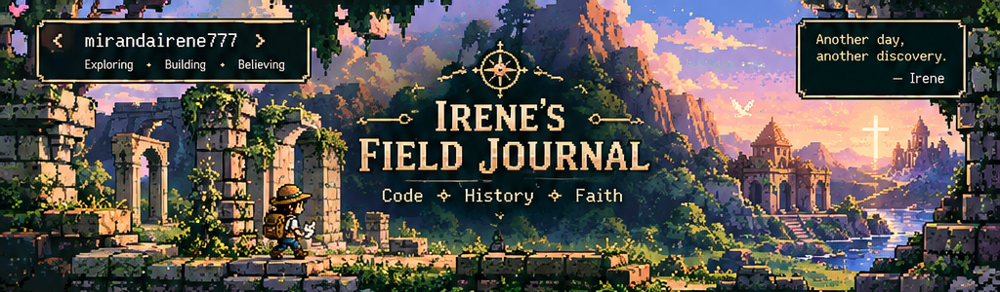
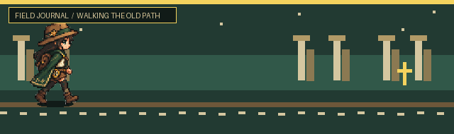

  

# ✦ IRENE'S FIELD JOURNAL ✦

**✝️ Follower of Jesus Christ · 💻 CS Student · 🗺️ Explorer at Heart**

*An archive of faith, forgotten worlds, and things built with code.*

[🌐 Portfolio](https://irenemiranda.dev) · [📂 Repositories](https://github.com/mirandairene777?tab=repositories)

`FIELD NOTES: 001` · `LOCATION: THE DIGITAL FRONTIER` · `STATUS: EXPLORING`

  

  <b>EXPLORE</b> · <b>DISCOVER</b> · <b>WALK BY FAITH</b>

  “Trust in the LORD with all your heart...”
   
  Proverbs 3:5–6 (NLT)

---

## 🧭 `01 // THE EXPLORER`

Hey, I'm Irene!

I'm a Computer Science student who loves learning, exploring ideas, and creating things with technology. Outside the world of code, I'm fascinated by history, archaeology, ancient places, and the stories that survive through time.

But the most important part of my journey is my faith in Jesus Christ.

I want to use what I learn to create things that are useful, meaningful, and helpful to others. I'm still growing as a developer, and I want every step of that journey to reflect the One I follow.

- ✝️ **My foundation:** Jesus Christ.
- 🏺 **My curiosity:** History, archaeology, and exploration.
- 💻 **My craft:** Software development and game creation.
- 🌱 **My goal:** Keep learning and use my abilities with purpose.

## 📜 `02 // THE LIVING WORD`

### Proverbs 3:5–6 · NLT

*"Trust in the LORD with all your heart"*

**— Proverbs 3:5**

This is the Scripture I want to carry through every season of my life.

I don't know everything about the future, and I don't always understand the path ahead. But I want to keep trusting God, acknowledging Him in my decisions, and allowing His Word to guide me.

My ambition isn't just to become a developer. I want to follow Jesus faithfully and use the abilities He has given me to serve others.

---

## 🕯️ `03 // MY TESTIMONY`

### From darkness to light

My story hasn't been an easy one.

I grew up carrying pain from childhood experiences and family difficulties. There were seasons when I struggled with emptiness, hopelessness, and questions about my purpose.

Later, while caring for my father through serious illness, I experienced exhaustion, grief, and some of the hardest moments of my life. In those dark seasons, I found myself turning to God in prayer.

When I lost my father, my life changed in ways I couldn't have imagined. Through grief and surrender, my relationship with Jesus became deeply personal. I chose to give my life to God, and I began learning to trust Him even when I couldn't understand what was happening.

Forgiveness wasn't easy, and healing wasn't something I could simply switch on. But I am grateful for the work God has done in my life, and I want to keep growing in His grace.

**Jesus is not just a chapter in my story. He is the One I want my whole life to point toward.**

📖 A note for anyone going through a dark season

If life feels heavy right now, you don't have to pretend that everything is okay.

I know what it feels like to struggle, to grieve, and to wonder what comes next. My testimony isn't that life suddenly became perfect. It's that I found a reason to keep turning to Jesus.

You are welcome here, and I hope my story encourages you to seek Him.

## ✝️ `04 // THE GOOD NEWS`

### The Gospel of Jesus Christ

The heart of my faith is the good news of Jesus.

- **God loves us.** He created us for a relationship with Him.
- **We have all sinned.** We cannot earn our salvation through our own goodness.
- **Jesus died and rose again.** Through Him, forgiveness and reconciliation with God are offered to us.
- **Salvation is a gift of grace.** We are saved through faith in Jesus Christ, not through our achievements.
- **We are invited to follow Him.** We can turn to God, trust in Christ, and grow in a life shaped by His Word.

> "For the wages of sin is death, but the free gift of God is eternal life through Christ Jesus our Lord."
>
> — Romans 6:23, NLT

If you're curious about Jesus, you're welcome to explore Scripture, ask questions, and learn about Him. You don't have to pretend to have everything figured out before you start seeking God.

**Soli Deo Gloria — Glory to God alone.**

---

## 🏺 `05 // THE ARTIFACT COLLECTION`

*Every project is a discovery. Every challenge is a chance to learn.*

<table>
<tr>
<td width="50%" valign="top">

### 🌊 Disaster Risk Profiler

A project focused on organizing household and resident information for barangay disaster risk profiling.

**Exploring**
- Python
- MySQL
- Desktop application development
- Database design

[Project repository — add link when available](#)

</td>
<td width="50%" valign="top">

### 🌿 Flo Tracker

A Flutter application project developed with teammates, currently under construction.

**Exploring**
- Dart and Flutter
- Application development
- Local data storage

[Explore Flo Tracker →](https://github.com/mirandairene777/flo-tracker)

</td>
</tr>
<tr>
<td width="50%" valign="top">

### 🗺️ LSPU Campus Navigator

A campus navigation project built with Flutter, designed to help users explore campus locations and find facilities.

**Features described in the project README**
- Interactive campus map
- Search and category filtering
- Responsive layouts

[Explore Campus Navigator →](https://github.com/mirandairene777/LSPU-NAVIGATION-CAMPUS)

</td>
<td width="50%" valign="top">

### 🎮 Uncanny — Unity Game

A collaborative 3D Unity game project.

**Exploring**
- Unity
- C#
- 3D game development

[Explore the team repository →](https://github.com/matcha-jillyace/Uncanny)

</td>
</tr>
</table>

## 🧰 `06 // THE EXPLORER'S TOOLKIT`

*Tools I'm learning and using along the way — always a work in progress.*

## 🗺️ `07 // EXPEDITION LOG`

## 🌿 `08 // UNEXPLORED TERRITORIES`

Future discoveries I'm excited to pursue:

- Artificial intelligence and machine learning.
- Web development and thoughtful user experiences.
- Game development and interactive storytelling.
- History, archaeology, and the preservation of knowledge.
- Technology that can help people and serve a greater purpose.

The journey is still unfolding. There's so much more to learn, build, and discover.

---

### ✦ SOLI DEO GLORIA ✦

*For the glory of God alone.*

**"Trust in the LORD with all your heart." — Proverbs 3:5, NLT**

Thank you for visiting my Field Journal.

May whatever I learn, create, and become bring glory to Jesus Christ.

[🌐 My Website](https://irenemiranda.dev) · [🗺️ Explore My Repositories](https://github.com/mirandairene777?tab=repositories)

`END OF FIELD NOTES // THE EXPEDITION CONTINUES`

